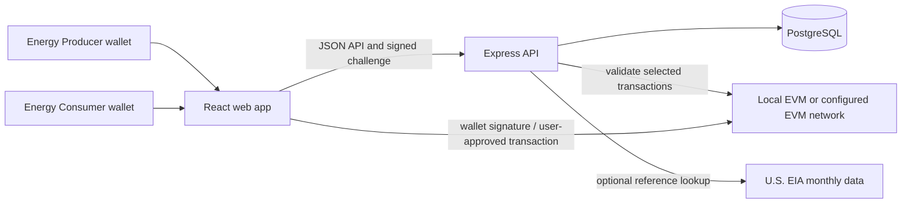

<div align="center">

# Bright Ledger

### The Future of Energy

An extensible peer-to-peer energy marketplace for coordinating renewable-energy offers, buyer requests, and auditable trade records.

[Get started](#quickstart) · [How it works](#how-it-works) · [Architecture](#architecture) · [Contribute](CONTRIBUTING.md)

</div>

---

## The challenge

Rooftop solar and other distributed renewable resources are growing, but local energy producers and consumers have limited ways to discover compatible offers, compare terms, and coordinate transparent records. Energy markets also differ by jurisdiction, making one-size-fits-all trading software difficult to adapt.

Peer-to-peer coordination may help make local clean-energy activity more visible and easier to organize. A software marketplace alone, however, does not route electricity, settle utility bills, validate meter data, or establish regulatory permission.

## Our approach

Bright Ledger brings the marketplace workflow into one modular application. Participants can create energy offers or requests, evaluate compatible listings, reserve a proposed trade, and follow confirmations and evidence through a recorded lifecycle. The default Docker stack runs the PostgreSQL-backed Express API, a local EVM, and a Vite frontend. Private workspace data requires an account session stored in the database and revocable by the user.

The implementation adapts ideas from the research paper [“BPET: A Unified Blockchain-Based Framework for Peer-to-Peer Energy Trading”](https://doi.org/10.3390/fi16050162) (Fan, Khazaei, and Musilek, *Future Internet*, 2024). The API, data model, matching policy, and contract are Bright Ledger implementation choices—not claims made by the paper.

## What it does

- **Accounts:** register with a unique username and a password of at least 12 characters, or sign in with an EVM wallet. Passwords are scrypt-hashed; opaque sessions are stored in PostgreSQL, expire after eight hours or 30 minutes idle, and can be revoked. Password recovery is not configured, so use a unique password. Password accounts may link a wallet later by signing an ownership challenge. Until a wallet is linked, wallet-dependent listing, trade, and blockchain actions are unavailable.
- **Browser EVM wallets:** choose an injected EVM provider detected through EIP-6963 or the legacy browser provider interface. This can include Trust Wallet and Phantom when its EVM mode is enabled. Solana-only Phantom and mobile deep links are not supported. Bright Ledger never requests a seed phrase or private key.
- **Energy marketplace:** publish offers and buy requests with a quantity, USD/kWh price, service area, renewable source, and delivery window.
- **Global locations:** sample marketplace and solar-project records cover capital cities across Asia and Africa, alongside projects in Türkiye, the United Kingdom, and the United States. Participants can enter their own city and country when listing energy or a site.
- **Rule-based matching:** check service area, available quantity, price limits, and delivery-window overlap.
- **Trade lifecycle:** both participants confirm the terms; the buyer funds configured escrow; the seller submits delivery evidence; the buyer approves to complete the trade or opens a dispute for verifier resolution. In non-escrow deployments, approval completes the shared trade record without moving funds.
- **Testnet trade escrow:** on Ethereum Sepolia, only the buyer funds the ETH/USD-feed-priced native SepoliaETH escrow. Buyer approval releases it to the seller; opening a dispute keeps it locked until an authorized verifier releases it or refunds the buyer. The backend verifies contract receipts and never holds user keys or funds. SepoliaETH and this payment flow are test-only.
- **Wallet network awareness:** the workspace displays the connected wallet's EVM network and chain ID. Contract actions are limited to the chain configured for that backend deployment; switching a wallet to Ethereum or Polygon does not deploy a contract or configure an RPC. XRP Ledger needs a separate integration and is not supported by the current EVM transaction flow.
- **Market-price context:** optionally display a U.S. EIA monthly retail-price reference. It is a contextual benchmark—not a real-time wholesale or local settlement price.
- **Community-solar projects:** any signed-in participant role can submit a project and cost-based funding estimate for independent review, register simulated interest while a project is under review or approved for fundraising, and record simulated income allocations for active projects. Pending-review interest does not bypass independent approval. AI assessment is optional and requires consent. Income is allocated by the project agreement and recorded for demonstration only; the platform does not collect investments, verify actual proceeds, or transfer or pay money. Site approval remains restricted to operator-authorized verifiers/admins.
- **Landowner-led fundraising:** a rooftop or land owner can submit a site, document permission, calculate a cost-based target, choose an agreement allocation, and publish a fundraising page only after independent review. The current contribution UI records simulated, non-cash interest; it is not a live investment product.
- **Bonded Operator Assurance (BOA):** the project operator can lock a separate refundable performance bond in the `BondedOperatorAssurance` contract. The bond is used for defined performance obligations and milestone accountability; it is never a substitute for project insurance, a guarantee of investor principal, or a right to investor funds.
- **Professional participant terms:** Energy Producers offer generated energy; Energy Consumers request or purchase it. Any participant can propose a community-solar project; the submitting participant is recorded as its Project Owner. All roles can register simulated, non-cash interest during project review or fundraising. These records are not real investments or funding commitments.
- **Extensible workspace:** frontend, backend, and blockchain code are separated into npm workspaces for independent development and deployment.

### Climate impact and responsible claims

Bright Ledger is intended to support renewable-energy visibility and community coordination. The current prototype does **not** establish that renewable electricity was delivered, prove additional generation, or verify avoided emissions. Any future impact reporting should be based on trusted meter or utility data, a documented emissions methodology, and independent review—not on marketplace entries alone.

## Innovation and AI

The marketplace uses **deterministic, explainable matching rules**. Optional, consent-gated AI provides a preliminary evidence triage and a solar funding-plan review. Evidence files (JPEG, PNG, WebP, PDF, or UTF-8 CSV; 8 MB maximum) are stored with their SHA-256 digest in PostgreSQL so authorized trade participants and verifiers can retrieve them. A file is sent to OpenRouter only when the user explicitly requests an AI check and gives consent; users should review the provider's current data policies before uploading anything sensitive.

For solar planning, the funding amount is calculated from user-entered USD line items plus a contingency, not generated or market-verified by AI. AI can offer a non-binding review and proposed revenue split; users must review and select project terms themselves. AI output is untrusted and advisory: it cannot authenticate a meter, prove generation or delivery, approve evidence, validate project costs, or provide investment advice. The trade buyer reviews delivery evidence; operator-authorized verifiers resolve disputes. The selected model and PDF parsing options may have availability, rate, or provider-policy limits; configure a private OpenRouter key on the backend to enable AI features.

## Landowner-to-solar-project flow

The intended product experience is a controlled path from a site owner's idea to verified energy settlement:

1. **Submit the site:** the landowner or rooftop owner creates a project with a public location, site type, usable area, permission status, notes, and fictional/sample details. No property title is transferred to Bright Ledger.
2. **Prepare the funding plan:** the owner enters equipment, installation, permitting, interconnection, and other costs plus contingency. Bright Ledger calculates an indicative target and capacity estimate. AI review is optional and advisory.
3. **Set the project agreement:** the owner selects energy and revenue shares, reserve/fee assumptions, funding deadline, and the operator's duties. The agreement must be versioned and visible before anyone records interest.
4. **Independent site review:** a verifier or admin checks permission evidence, site assumptions, budget plausibility, conflict disclosures, and the proposed operator. Approval allows fundraising; it does not guarantee construction, generation, returns, or regulatory permission.
5. **Appoint and bond the operator:** the operator is identified in the project record and posts a separate BOA performance bond. The operator can coordinate vendors and submit evidence, but cannot approve its own milestones or withdraw project funding.
6. **Raise funds in a project vault:** in a production implementation, each investor contribution goes to a project-specific `ProjectEscrow` with exact per-investor accounting, a funding cap, deadline, and refund path. It must never enter the operator wallet or BOA vault. The current MVP records simulated contribution interest instead of collecting money.
7. **Release milestone tranches:** the operator submits invoices, delivery records, serial numbers, installation reports, and time-stamped evidence. An independent verifier approves only the relevant tranche; disputed amounts remain frozen.
8. **Verify generation:** authenticated meter/oracle data moves through reported, validated, verified, and settled states. An oracle transports evidence; it does not prove that a physical meter is honest.
9. **Settle energy proceeds:** a signed settlement statement applies only disclosed charges, reserves, and fees, then credits beneficiaries according to the approved agreement. Production payouts should use pull withdrawals, not operator-controlled transfers.
10. **Close out or resolve claims:** after the service period and challenge window, the bond is released if obligations are complete. A defined breach can trigger a partial slash after notice, evidence review, and appeal; unrestricted confiscation is not part of the design.

### Fund and vault separation

```text
Investor contributions  --> ProjectEscrow / MilestoneEscrow --> approved vendor or refund
Operator performance bond --> BondedOperatorAssurance     --> operator release or defined slash
Verified energy proceeds --> SettlementEngine / PayoutVault --> owner, investors, community
```

These are separate balances, permissions, and accounting domains:

- The **operator cannot freely withdraw investor funds**.
- The **BOA bond does not guarantee all project principal or energy output**.
- A milestone approval releases only the approved tranche to an allowlisted destination.
- A failed funding deadline has a predefined refund path.
- Settlement credits are allocated from verified, approved proceeds; they are not minted by the operator.

## Governance model for a project fund and vault

Governance should be explicit, role-separated, and visible to every participant:

| Role | Responsibilities | Cannot do |
| --- | --- | --- |
| Landowner / site owner | Provide site authority, approve the project agreement, receive owner allocation | Release escrow alone or alter investor balances |
| Investor | Review disclosures, contribute, inspect evidence, challenge within the window, withdraw credits | Change terms unilaterally or approve the operator's own claim |
| Operator / project manager | Coordinate execution, submit milestones, maintain vendor records, propose settlement | Custody investor funds, self-approve evidence, change splits |
| Independent verifier | Review site, milestone, meter, and dispute evidence | Move funds for personal benefit or rewrite past records |
| Settlement role | Validate the approved statement and trigger allocation | Change the agreement or override verified readings |
| Governance multisig | Pause scoped functions, rotate compromised roles, approve exceptional actions | Arbitrarily seize user balances or bypass the dispute process |
| Timelock | Delay role, parameter, or contract changes for public notice | Act as an emergency drain or ordinary operator |

Minimum governance rules:

1. Store the project agreement hash, version, shares, cap, deadline, and approved destinations.
2. Use a multisig for governance and a timelock for non-emergency changes.
3. Require independent verification and a challenge window for milestone and settlement approvals.
4. Use pull-based withdrawals and emit deposit, approval, refund, slash, release, and withdrawal events.
5. Pause only the affected function during an incident; preserve withdrawals and refunds where safe.
6. Require conflict-of-interest disclosure, verifier rotation, audit logs, and a documented recovery runbook.
7. Never add an unrestricted `adminWithdraw`, `adminSlashAll`, or hidden balance-minting path.

This governance model is an architecture specification for a hackathon MVP. It is not an audited guarantee of security, enforceability, investment performance, or regulatory approval.

## How it works



1. A participant connects a wallet and signs a one-time account challenge.
2. An Energy Producer publishes an offer or an Energy Consumer publishes a request.
3. The marketplace filters listings; the API applies the compatibility rules when a trade is proposed.
4. Both participants confirm the agreed terms. If Sepolia escrow is configured, only the buyer funds it; evidence submission is not a payment.
5. The seller submits delivery evidence. The buyer checks the record and either approves it to release escrow to the seller or opens a dispute, which leaves escrow locked.
6. An operator-authorized verifier resolves an open dispute by releasing escrow to the seller or refunding it to the buyer.
7. The API checks the configured contract's transaction receipts and event data before accepting chain-backed transitions. It does not custody funds or submit transactions for users.

## Quickstart

### Requirements

- Docker Desktop with Docker Compose
- A browser with MetaMask or another compatible injected EVM wallet for wallet signup

### Local run checklist

1. Clone the repository and open a terminal at its root.
2. Start Docker Desktop and confirm the Linux container engine is running.
3. Use only a development wallet and test accounts. Never import a production seed phrase.
4. Run `docker compose up --build` and wait for the PostgreSQL, local EVM, and API health checks; the frontend starts after the API is healthy.
5. Add the local network to the wallet with RPC `http://127.0.0.1:8545` and chain ID `31337`.
6. To obtain valueless local ETH, run `docker compose logs blockchain` and import one of the Hardhat node's printed private test accounts into the wallet. Use a different test account for the second participant. Never use these keys outside the local chain.
7. Open [http://localhost:5173](http://localhost:5173), create two wallet profiles, and use one as seller/operator and one as buyer/investor.
8. Check [http://localhost:4000/api/health](http://localhost:4000/api/health) before testing flows.
9. For a clean reset, stop Compose and run `docker compose down -v`; this deletes local PostgreSQL and chain data.

### Run the complete local stack

From the project directory:

```sh
docker compose up --build
```

Compose builds the app image, starts PostgreSQL and a local Hardhat EVM, deploys the trading and BOA contracts, and starts the **PostgreSQL-backed API** and frontend after the database, chain, and API health checks pass. New accounts must connect a compatible wallet and sign in. There are no sample-user sign-ins or seeded marketplace records; project listings are hidden until they have an associated completed AI-reviewed estimate. No host Node.js installation or `.env` file is required for the local run.

| Service | Local address |
| --- | --- |
| Bright Ledger web app | [http://localhost:5173](http://localhost:5173) |
| API health | [http://localhost:4000/api/health](http://localhost:4000/api/health) |
| Local EVM JSON-RPC | `http://127.0.0.1:8545` |
| Local EVM chain ID | `31337` |

The API health endpoint identifies PostgreSQL as `connected` and reports the local EVM connection. New listings, trades, evidence records, funding estimates, solar project submissions, and notification state are stored in PostgreSQL. Compose preserves PostgreSQL data in the `bright-ledger-postgres` volume across restarts. This is still a prototype: use fictional/sample personal and site details, test wallet accounts only, and never send real funds. Evidence files are stored in PostgreSQL and are available only to trade participants and authorized verifiers. AI review requires a backend OpenRouter key and explicit consent; the review is advisory. Review the provider's terms before uploading anything. Wallet-authenticated users can use the configured local test contract and must approve each wallet transaction. Use only local test accounts and valueless test ETH. Keep the Compose terminal open to view logs. Stop services with `Ctrl+C` or:

```sh
docker compose down
```

The local contract address is stored in a Docker volume and passed to the PostgreSQL-backed API. `docker compose down` preserves PostgreSQL and local chain data. `docker compose down -v` deletes local Compose data volumes, including the database and local chain state.

To enable AI evidence triage and optional solar funding-plan review, put `OPENROUTER_API_KEY` in a root `.env` file before running Compose. The key stays in the API container and is never sent to the frontend. Without a key, marketplace, human evidence review, cost-based project estimates, and project submission still work. Never commit `.env`.

### Run without Docker

For development without Compose, start PostgreSQL, configure `DATABASE_URL` and `API_ORIGIN` in `.env`, then run `npm install` and `npm run dev`. The API and Vite frontend run separately on ports `4000` and `5173`. Optional AI project assessment requires `OPENROUTER_API_KEY`; the local EVM is optional for database-backed workflows.

### Connect MetaMask to the local network

In MetaMask, add a network with:

| Setting | Value |
| --- | --- |
| Network name | Bright Ledger Local |
| RPC URL | `http://127.0.0.1:8545` |
| Chain ID | `31337` |
| Currency symbol | `ETH` |

Use the wallet signup form in Bright Ledger and approve the connection and message-signature requests in MetaMask. Local Hardhat accounts and funds are for development only; their private keys are public test keys and must never be used on a public network.

### Alchemy RPC demo and testnet deployments

The Node RPC demo reads Ethereum Mainnet's chain ID and latest block number. From the repository root, copy `.env.example` to `.env` and set `ALCHEMY_API_KEY` to your Alchemy key. The key is loaded by `dotenv`, is read only by Node code, and must never be added to a `VITE_*` variable or committed.

Run the demo with:

```sh
npm run demo:alchemy --workspace @bright-ledger/backend
```

It prints JSON containing `chainId` (`1` for Ethereum Mainnet) and `latestBlockNumber`. The block number changes as the network advances. The request uses Alchemy's `eth_chainId` and `eth_blockNumber` JSON-RPC methods; it does not sign or send a transaction.

For Ethereum Sepolia contract deployment, set `SEPOLIA_RPC_URL` (defaults to `https://ethereum-sepolia-rpc.publicnode.com`) and `DEPLOYER_PRIVATE_KEY` in `blockchain/.env`. Use a newly created test-only wallet with SepoliaETH; never use a mainnet wallet key or a key that has been shared publicly. `blockchain/.env` is ignored by Git. Compile and test from the repository root, then deploy from the repository root with:

```sh
npm run chain:compile
npm run chain:test
npm run chain:deploy:sepolia
```

The deploy command prints both the trading contract and the `BondedOperatorAssurance` vault address. Set `CONTRACT_ADDRESS`, `BOA_CONTRACT_ADDRESS`, `CHAIN_ID=11155111`, and `CHAIN_RPC_URL` to the same Sepolia RPC in the backend's server-side environment, then redeploy the backend and connect wallets to Ethereum Sepolia. The BOA vault holds only the operator's refundable performance bond; it never holds investor/project funding. Configure dispute and milestone verifiers both in the contracts (`setVerifier`) and in the backend's `VERIFIER_WALLET_ADDRESSES`. The deployer key stays local and is not needed by the running app. Base Sepolia remains available as record-only with `BASE_SEPOLIA_RPC_URL` (or `BASE_SEPOLIA_ALCHEMY_API_KEY`) and `npm run deploy:base-sepolia --workspace @bright-ledger/blockchain`.

### What is deployed today

- **Local Compose:** a fresh local Hardhat EVM, `EnergyTrading`, `BondedOperatorAssurance`, PostgreSQL migrations, Express API, and Vite frontend. Local contract addresses are generated for that Docker volume and are not public deployments.
- **Ethereum Sepolia path:** the repository contains the deployment script and contract artifacts for `EnergyTrading` and `BondedOperatorAssurance`. A public deployment exists only after an operator runs `npm run chain:deploy:sepolia` with a test-only deployer key and records both printed addresses in the backend environment.
- **Backend:** validates wallet signatures, database state, and chain receipts/events. It never receives private keys and never acts as a user transaction signer.
- **Current funding limitation:** project contributions and income allocations in the MVP are simulated database records. A production `ProjectEscrow`, regulated offering flow, investor eligibility checks, refunds, and payout vault still require implementation, legal review, and security audit before real money is accepted.

### Try the marketplace

1. Create a wallet profile with the **Energy Producer** role.
2. Open **Energy market → Create listing**, publish an **Offer**, and enter its quantity, USD/kWh price, service area, renewable source, and delivery window.
3. Use a different wallet to create an **Energy Consumer** profile.
4. In the buyer account, select the offer and request a match. The resulting trade appears under **Trades**.
5. Both parties confirm the terms. Where Sepolia escrow is configured, the buyer funds it. The seller submits delivery evidence (optionally with a meter file and consented AI triage); the buyer approves to complete the trade or opens a dispute for verifier resolution. Non-escrow deployments record completion without moving funds.

On Ethereum Sepolia, the buyer can escrow the quoted SepoliaETH amount and the contract releases or refunds it according to evidence review. Test ETH has no real-world value. The transaction does not deliver electricity, and separate participants are needed to match one another's listings.

## Architecture

```text
bright-ledger/
├── frontend/          # React + TypeScript + Vite application
├── backend/           # Persistent Express API, PostgreSQL access, migrations, tests
├── blockchain/        # Solidity contracts, Hardhat deployment and tests
├── docker-compose.yml # Local database, EVM, API, and frontend services
├── Dockerfile         # Shared local development image
└── package.json       # npm workspaces and root-level commands
```

### Technology

| Layer | Technologies |
| --- | --- |
| Frontend | React, TypeScript, Vite, CSS, ethers.js |
| Backend | Node.js 22+, Express, TypeScript, Zod, Multer, database-backed wallet sessions, ethers.js |
| Database | PostgreSQL |
| Smart contracts | Solidity, Hardhat, local EVM |
| Evidence triage | OpenRouter multimodal API (optional, advisory only) |
| External reference | Optional EIA monthly U.S. retail electricity-price API |
| Local orchestration | Docker Compose |
| Hosting configuration | Render (API), Vercel (frontend), Neon (PostgreSQL) |

### Implemented contract responsibilities

| Contract | Implemented responsibility | Boundary |
| --- | --- | --- |
| `EnergyTrading` | Trade commitment, optional SepoliaETH escrow, evidence review, dispute resolution, release/refund | Does not route electricity or prove a physical meter reading |
| `BondedOperatorAssurance` | Project-scoped operator bond, milestone evidence hash, verifier decision, partial slash, timelocked release | Does not hold investor contributions, guarantee project returns, or replace governance |

The BOA contract is intentionally separate from marketplace trade escrow. Its governance address can authorize verifiers; the operator can release only its own bond after the unlock time; verifiers can approve milestones or apply a defined partial slash. Production deployments should add a multisig, timelock, dispute manager, project escrow, payout vault, oracle controls, and an independent audit.

### Scale and extension

Both Compose and `npm run dev` use the PostgreSQL-backed API. Payments and energy delivery are not real.

The frontend, API, database, and contract package have distinct responsibilities and can be developed and deployed separately. PostgreSQL transactions and constraints protect important marketplace operations; versioned migrations make schema evolution explicit; matching and AI evidence triage are isolated from route handling so market rules and analysis providers can be extended. Uploads are bounded and processed in memory before being stored as PostgreSQL evidence records; the API does not retain a separate filesystem copy.

The repository is a foundation, **not a claim of production-scale capacity**. Scaling for real participants would require load and contention testing, managed database sizing and connection pooling, monitoring, backups, rate-limit tuning, robust asynchronous jobs where appropriate, and an operational process for migrations and privileged roles.

## Development

For a single-command local environment, use Docker Compose as described above. For individual packages, install the workspace dependencies from the root with `npm install`. Backend-only or browser-only development commands and environment settings are documented in [`backend/README.md`](backend/README.md) and [`CONTRIBUTING.md`](CONTRIBUTING.md).

Common root commands:

| Command | Purpose |
| --- | --- |
| `npm run dev:frontend` | Run Vite only |
| `npm run dev:backend` | Run the PostgreSQL-backed API only (requires PostgreSQL and `.env`) |
| `npm run dev` | Run the PostgreSQL-backed API and frontend together |
| `npm run build` | Build frontend, backend, and compile the contract |
| `npm run build:blockchain` | Compile Solidity contract artifacts |
| `npm run lint` | Lint application and contract source |
| `npm run test:backend` | Run backend policy and benchmark tests |
| `npm run chain:compile` | Compile Solidity |
| `npm run chain:test` | Run contract tests |
| `npm run chain:deploy:sepolia` | Deploy the contract once to Ethereum Sepolia |

## Team workflow

Use short-lived feature branches and pull requests; keep `main` deployable and avoid committing directly to it. See [`CONTRIBUTING.md`](CONTRIBUTING.md) for branch naming, review expectations, and the recommended GitHub setup.

## Deployment

- **Hosting target:** [`render.yaml`](render.yaml) defines the Render Docker API service. The Vite frontend is deployed separately on Vercel, and the API uses the Neon PostgreSQL database; neither the frontend nor database is provisioned by the Render Blueprint. The blockchain is a deployed Sepolia contract, not a server process to start.
- **Hosting environment setup:** set `DATABASE_URL` to the Neon connection string and `DATABASE_SSL=true` on Render. Set Render's `API_ORIGIN` and `AUTH_URI` to the Vercel frontend's HTTPS origin. Set Vercel's `VITE_API_BASE_URL` to the Render API's HTTPS origin and redeploy Vercel after changing it. Configure `CHAIN_RPC_URL`, `CHAIN_ID`, `CONTRACT_ADDRESS`, and `BOA_CONTRACT_ADDRESS` for the selected deployed network.
- **Build:** from the repository root run `npm run build`; this builds the frontend and backend and compiles the Solidity contract. Run `npm run chain:test` to validate contract behavior.
- **Frontend:** build with `npm run build:frontend` and publish `frontend/dist`. Set `VITE_API_BASE_URL` to the deployed API's HTTPS origin before building.
- **Backend:** build and start the standalone `backend/` package with `npm run build` and `npm start` from `backend/`. Configure `DATABASE_URL`, the frontend `API_ORIGIN`, the deployed frontend `AUTH_URI`, the public wallet-signing `AUTH_DOMAIN`, and the `CHAIN_ID`. Add only operator-controlled wallet addresses to `ADMIN_WALLET_ADDRESSES`, `VERIFIER_WALLET_ADDRESSES`, and `SPACE_OWNER_WALLET_ADDRESSES`. Sessions are database-backed; no JWT signing secret is used.
- **AI evidence triage:** set `OPENROUTER_API_KEY` and (optionally) `OPENROUTER_MODEL` in the backend host's secret/environment settings. Never expose the key as a `VITE_*` variable. Without a key, the rest of the app works and the API returns a clear AI-not-configured response.
- **Solar funding and income records:** all authenticated roles can submit projects and calculate USD funding needs from cost categories and contingency. Optional AI review requires consent. Simulated income distributions follow the saved revenue shares and are audit-recorded; they do not represent verified proceeds or transfer money. Project approval remains restricted to authorized verifiers/admins.
- **Database:** use a managed PostgreSQL service for hosted environments; account for its connection limits, backups, TLS requirements, and availability characteristics.
- **Blockchain deployment:** deploy once from a trusted local machine or CI runner with `npm run chain:deploy:sepolia`. The deployment key stays in local `blockchain/.env`; never put it on Render, Vercel, or in the browser. Configure the backend with `CHAIN_RPC_URL=https://ethereum-sepolia-rpc.publicnode.com`, `CHAIN_ID=11155111`, and both printed contract addresses. The backend verifies BOA receipts and event parameters before recording bond or milestone state; no `npm start` process is needed for the blockchain workspace.
- **Trade payments:** only the buyer approves the exact contract quote in MetaMask. The Sepolia ETH/USD Chainlink feed is used by the contract to calculate the agreed USD total in native SepoliaETH. The buyer's approval of seller evidence releases escrow; a buyer dispute keeps escrow locked until a verifier decides to release or refund it. MetaMask does not convert a USD invoice automatically. The browser presents the quote, and the buyer pays network gas separately. This is a testnet prototype, not a production payment system.

Never commit `.env` files, private keys, API keys, or production credentials. Do not put secrets in `VITE_*` variables.

## Limitations

Bright Ledger is an engineering prototype, not a utility, energy supplier, financial product, carbon registry, or regulated market operator. Ethereum Sepolia escrow is testnet-only; the test ETH has no real-world value. The prototype does not move electricity, and meter evidence, energy delivery, project funding, reward points, and emissions assumptions are not independently verified by this software. Real-world payment use requires jurisdiction-specific approvals, trusted data integrations, privacy and dispute controls, independent contract review, and a defensible impact methodology.

## Research

Fan, C.; Khazaei, H.; Musilek, P. “BPET: A Unified Blockchain-Based Framework for Peer-to-Peer Energy Trading.” *Future Internet* 16 (2024), 162. [https://doi.org/10.3390/fi16050162](https://doi.org/10.3390/fi16050162).
