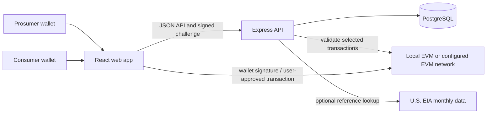

<div align="center">

# Bright Ledger

### Local clean energy, made visible.

An extensible peer-to-peer energy marketplace for exploring how communities could coordinate renewable-energy offers, buyer requests, and auditable trade records.

[Get started](#quickstart) · [How it works](#how-it-works) · [Architecture](#architecture) · [Contribute](CONTRIBUTING.md)

</div>

---

## The challenge

Rooftop solar and other distributed renewable resources are growing, but local energy producers and consumers have limited ways to discover compatible offers, compare terms, and coordinate transparent records. Energy markets also differ by jurisdiction, making one-size-fits-all trading software difficult to adapt.

Peer-to-peer coordination may help make local clean-energy activity more visible and easier to organize. A software marketplace alone, however, does not route electricity, settle utility bills, validate meter data, or establish regulatory permission.

## Our approach

Bright Ledger brings the marketplace workflow into one modular application. Participants can create energy offers or requests, evaluate compatible listings, reserve a proposed trade, and follow confirmations and evidence through a recorded lifecycle. The default Docker stack runs the PostgreSQL-backed Express API, a local EVM, and a Vite frontend. PostgreSQL is the only supported application database; frontend and backend can also be developed and deployed separately.

The implementation adapts ideas from the research paper [“BPET: A Unified Blockchain-Based Framework for Peer-to-Peer Energy Trading”](https://doi.org/10.3390/fi16050162) (Fan, Khazaei, and Musilek, *Future Internet*, 2024). The API, data model, matching policy, and contract are Bright Ledger implementation choices—not claims made by the paper.

## What it does

- **Wallet-based accounts:** sign a one-time, short-lived authentication challenge using an injected EVM wallet. Sessions use random opaque bearer tokens whose hashes are stored in PostgreSQL; they expire after eight hours or 30 minutes of inactivity, can be revoked on signout, and are held in browser memory only. A page reload requires signing in again. Bright Ledger never needs a seed phrase or private key.
- **Energy marketplace:** publish offers and buy requests with a quantity, USD/kWh price, service area, renewable source, and delivery window.
- **Global locations:** sample marketplace listings include cities across multiple regions. Participants can enter their own city and country when listing energy or a solar site.
- **Rule-based matching:** check service area, available quantity, price limits, and delivery-window overlap.
- **Trade lifecycle:** record proposals, participant confirmations, evidence submissions, independent review, disputes, and settlement eligibility.
- **Tamper-evident records:** when a local or supported EVM contract is configured, selected trade events can be submitted and checked against the transaction receipt.
- **Wallet network awareness:** the workspace displays the connected wallet's EVM network and chain ID. Contract actions are limited to the chain configured for that backend deployment; switching a wallet to Ethereum or Polygon does not deploy a contract or configure an RPC. XRP Ledger needs a separate integration and is not supported by the current EVM transaction flow.
- **Price transparency:** listing prices are entered by participants in USD/kWh. An optional U.S. EIA monthly retail-price reference is contextual only—not a real-time wholesale or local settlement price.
- **Community-solar planning:** calculate funding from participant-entered cost categories, require a consented AI advisory review before saving an estimate, and submit a project linked to that estimate. Projects remain in review until an authorized verifier/admin approves or rejects them. Contributions are test records only; no funds move. Generation, dispute, attribute-allocation, and full solar settlement lifecycle routes are not part of the current PostgreSQL API.
- **Extensible workspace:** frontend, backend, and blockchain code are separated into npm workspaces for independent development and deployment.

### Climate impact and responsible claims

Bright Ledger is intended to support renewable-energy visibility and community coordination. The current prototype does **not** establish that renewable electricity was delivered, prove additional generation, or verify avoided emissions. Any future impact reporting should be based on trusted meter or utility data, a documented emissions methodology, and independent review—not on marketplace entries alone.

## Innovation and AI

The marketplace uses **deterministic, explainable matching rules**. Consent-gated AI provides a preliminary evidence triage and a solar funding-plan review. Evidence files (JPEG, PNG, WebP, PDF, or UTF-8 CSV; 8 MB maximum) are stored with their SHA-256 digest in PostgreSQL so authorized trade participants and verifiers can retrieve them. A file is sent to OpenRouter only when the user explicitly requests an AI check and gives consent; users should review the provider's current data policies before uploading anything sensitive. Solar estimates require a configured AI provider and explicit consent; if AI is unavailable, the API reports an error rather than saving an unreviewed estimate.

For solar planning, the funding amount is calculated from user-entered USD line items plus a contingency, not generated or market-verified by AI. AI can offer a non-binding review and proposed revenue split; users must review and select project terms themselves. AI output is untrusted and advisory: it cannot authenticate a meter, prove generation or delivery, approve evidence, validate project costs, or provide investment advice. Human verifier permissions and the existing review workflow remain mandatory. The selected model and PDF parsing options may have availability, rate, or provider-policy limits; configure a private OpenRouter key on the backend to enable AI features.

## How it works



1. A participant connects a wallet and signs a one-time account challenge.
2. A prosumer publishes an offer or a consumer publishes a request.
3. The marketplace filters listings; the API applies the compatibility rules when a trade is proposed.
4. Trade participants confirm the proposal. The seller can submit delivery evidence.
5. A separate authorized verifier reviews evidence; disputes and settlement eligibility are recorded.
6. If a contract is configured, the API checks submitted transaction receipts and matching event data before accepting supported chain-backed transitions.

## Quickstart

### Requirements

- Docker Desktop with Docker Compose
- A browser with MetaMask or another compatible injected EVM wallet for wallet signup

### Run the complete local stack

From the project directory:

```sh
docker compose up --build
```

Compose builds the app image, starts PostgreSQL and a local Hardhat EVM, deploys the contract, and starts the **PostgreSQL-backed API** and frontend after health checks pass. Local sample records are enabled for evaluation; all new marketplace actions are persisted in PostgreSQL, while contributions, payments, and electricity delivery remain simulated. No host Node.js installation or `.env` file is required for this local run.

| Service | Local address |
| --- | --- |
| Bright Ledger web app | [http://localhost:5173](http://localhost:5173) |
| API health | [http://localhost:4000/api/health](http://localhost:4000/api/health) |
| Local EVM JSON-RPC | `http://127.0.0.1:8545` |
| Local EVM chain ID | `31337` |

The API health endpoint identifies PostgreSQL as `connected` and reports the local EVM connection. Compose preserves PostgreSQL data in the `bright-ledger-postgres` volume across restarts. Seed records are fictional examples, not real participants or verified generation. Use sample personal and site details, test wallet accounts only, and never send real funds. The first-run disclosure explains these limits; do not upload genuine documents or connect a wallet holding assets. Evidence is stored in PostgreSQL and is available only to trade participants and authorized verifiers. AI review requires an OpenRouter key and explicit consent and is advisory. Local contract interactions require wallet approval and use valueless test ETH. Keep the Compose terminal open to view logs. Stop services with `Ctrl+C` or:

```sh
docker compose down
```

The local contract address is stored in a Docker volume and passed to the PostgreSQL-backed API. `docker compose down` preserves PostgreSQL and local chain data. `docker compose down -v` deletes local Compose data volumes, including the database and local chain state.

To enable AI evidence triage and solar funding-plan review, put `OPENROUTER_API_KEY` in a root `.env` file before running Compose. The key stays in the API container and is never sent to the frontend. Without a key, PostgreSQL and marketplace trading still work, but solar estimates cannot be saved because an AI review is mandatory. Never commit `.env`.

### Run without Docker

Start PostgreSQL (for example, `docker compose up -d postgres`), copy `.env.example` to `.env`, then install dependencies and start both the API and Vite frontend:

```powershell
npm install
Copy-Item .env.example .env
npm run dev
```

The API runs database migrations on startup. To enable local EVM actions, start the Compose blockchain service and set `CHAIN_RPC_URL` and `CONTRACT_ADDRESS` in `.env` to the running local service and deployed contract. `SEED_SAMPLE_DATA=true` loads fictional example records; it is false in the example environment by default.

### Connect MetaMask to the local network

In MetaMask, add a network with:

| Setting | Value |
| --- | --- |
| Network name | Bright Ledger Local |
| RPC URL | `http://127.0.0.1:8545` |
| Chain ID | `31337` |
| Currency symbol | `ETH` |

Use the wallet signup form in Bright Ledger and approve the connection and message-signature requests in MetaMask. Local Hardhat accounts and funds are for development only; their private keys are public test keys and must never be used on a public network.

### Try the marketplace

1. Create a wallet profile with the **Prosumer** role.
2. Open **Energy market → Create listing**, publish an **Offer**, and enter its quantity, USD/kWh price, service area, renewable source, and delivery window.
3. Use a different wallet to create a **Consumer** profile.
4. In the buyer account, select the offer and request a match. The resulting trade appears under **Trades**.
5. Follow the confirmation and evidence workflow. Sellers can optionally attach a meter file and request an AI triage report; a human verifier still reviews the record. Settlement remains gated on required confirmations and evidence review.
6. To submit a solar project, configure OpenRouter, enter cost assumptions, consent to the AI review, save the estimate, and submit matching project details. A trusted operator must grant the verifier/admin role to an authorized reviewer; only that role can approve a project for test contributions.

A trade record is not a payment or a physical electricity delivery. Separate participants are needed to match one another's listings. There is no public self-service verifier/admin role assignment; this must be provisioned by a trusted database operator.

## Architecture

```text
bright-ledger/
├── frontend/          # React + TypeScript + Vite application
├── backend/           # Persistent Express API, PostgreSQL access, migrations, tests
├── blockchain/        # Solidity contracts, Hardhat deployment and tests
├── docker-compose.yml # Local database, EVM, API, and frontend services
├── Dockerfile         # Shared local development image
└── package.json       # npm workspaces and root-level commands
```

### Technology

| Layer | Technologies |
| --- | --- |
| Frontend | React, TypeScript, Vite, CSS, ethers.js |
| Backend | Node.js 22+, Express, TypeScript, Zod, Multer, opaque database-backed sessions, ethers.js |
| Database | PostgreSQL for local development and deployments |
| Smart contracts | Solidity, Hardhat, local EVM |
| Evidence triage | OpenRouter multimodal API (optional, advisory only) |
| External reference | Optional EIA monthly U.S. retail electricity-price API |
| Local orchestration | Docker Compose |
| Hosting configuration | Vercel frontend and Render API blueprints |

### Scale and extension

Both Docker Compose and `npm run dev` use the PostgreSQL-backed API. Seed records are examples, and contributions, payments, and energy delivery are not real.

The frontend, API, database, and contract package have distinct responsibilities and can be developed and deployed separately. PostgreSQL transactions and constraints protect important marketplace operations; versioned migrations make schema evolution explicit; matching and AI evidence triage are isolated from route handling so market rules and analysis providers can be extended. Uploads are bounded and evidence files are stored in PostgreSQL.

The repository is a foundation, **not a claim of production-scale capacity**. Scaling for real participants would require load and contention testing, managed database sizing and connection pooling, monitoring, backups, rate-limit tuning, robust asynchronous jobs where appropriate, and an operational process for migrations and privileged roles.

## Development

For a single-command local environment, use Docker Compose as described above. For individual packages, install the workspace dependencies from the root with `npm install`. Backend-only or browser-only development commands and environment settings are documented in [`backend/README.md`](backend/README.md) and [`CONTRIBUTING.md`](CONTRIBUTING.md).

Common root commands:

| Command | Purpose |
| --- | --- |
| `npm run dev:frontend` | Run Vite only |
| `npm run dev:backend` | Run the PostgreSQL-backed API only (requires PostgreSQL and `.env`) |
| `npm run dev` | Run PostgreSQL-backed API and frontend together |
| `npm run build` | Build frontend and backend |
| `npm run lint` | Lint application and contract source |
| `npm run test:backend` | Run backend policy and benchmark tests |
| `npm run chain:compile` | Compile Solidity |
| `npm run chain:test` | Run contract tests |

## Team workflow

Use short-lived feature branches and pull requests; keep `main` deployable and avoid committing directly to it. See [`CONTRIBUTING.md`](CONTRIBUTING.md) for branch naming, review expectations, and the recommended GitHub setup.

## Deployment

- **Frontend:** Vercel can build the Vite application from the repository root. Configure `VITE_API_BASE_URL` with the deployed API's HTTPS origin.
- **Backend:** the Render blueprint runs the standalone `backend/` package. Configure a managed `DATABASE_URL`, the frontend `API_ORIGIN`, the deployed frontend origin as `AUTH_URI`, and a matching `AUTH_DOMAIN`. The app uses opaque sessions and does not require a JWT secret. Keep sample seeding disabled in deployments.
- **AI evidence triage:** set `OPENROUTER_API_KEY` and (optionally) `OPENROUTER_MODEL` in the backend host's secret/environment settings. Never expose the key as a `VITE_*` variable. Without a key, the rest of the app works and the API returns a clear AI-not-configured response.
- **Solar funding review:** the backend calculates USD funding needs from submitted cost categories and contingency, persists the plan only after a consented AI advisory response, and exposes the linked project only after submission. A verifier/admin must approve it before test contributions; no real funds move.
- **Database:** use a managed PostgreSQL service for hosted environments; account for its connection limits, backups, TLS requirements, and availability characteristics.
- **Blockchain:** deploy and configure a supported EVM contract and RPC separately before using chain-backed paths outside the local development environment.

Never commit `.env` files, private keys, API keys, or production credentials. Do not put secrets in `VITE_*` variables.

## Limitations

Bright Ledger is an engineering prototype, not a utility, energy supplier, financial product, carbon registry, or regulated market operator. It does not move electricity or money. Meter evidence, energy delivery, project funding, reward points, and emissions assumptions are not independently verified by this software. The PostgreSQL implementation does not currently include generation-batch, renewable-attribute, project-dispute, or full solar-settlement lifecycle APIs. Real-world use requires jurisdiction-specific approvals, trusted data integrations, privacy and dispute controls, independent contract review, and a defensible impact methodology.

## Research

Fan, C.; Khazaei, H.; Musilek, P. “BPET: A Unified Blockchain-Based Framework for Peer-to-Peer Energy Trading.” *Future Internet* 16 (2024), 162. [https://doi.org/10.3390/fi16050162](https://doi.org/10.3390/fi16050162).
